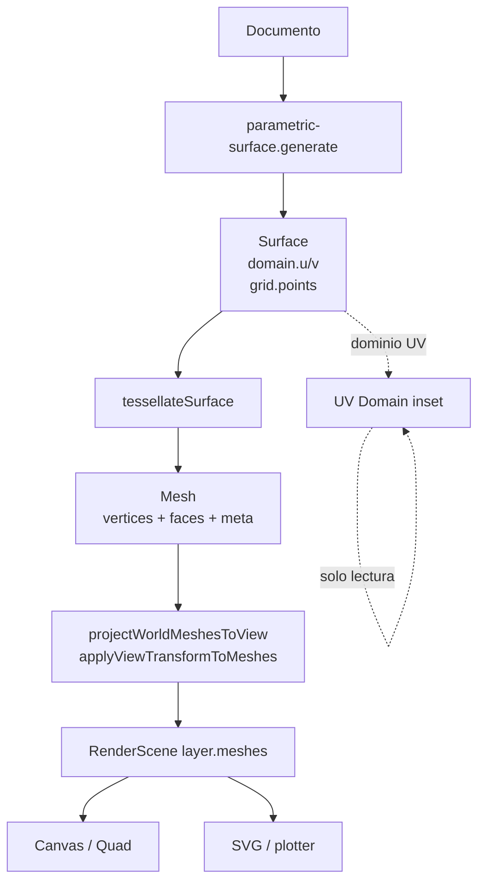
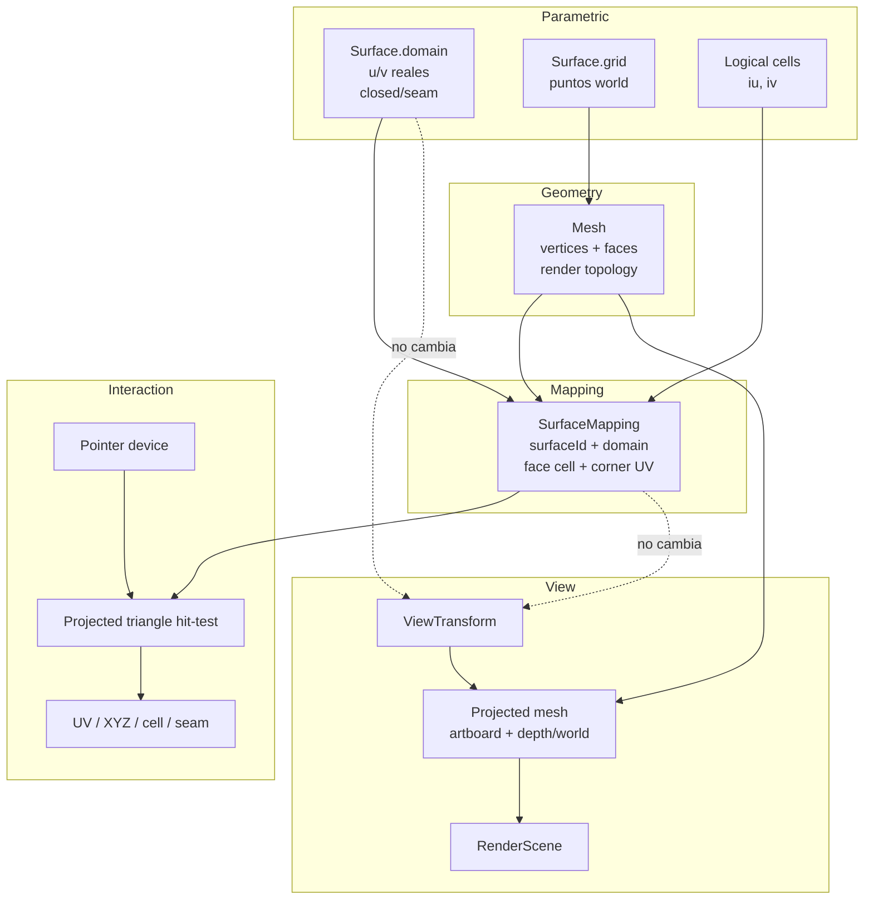
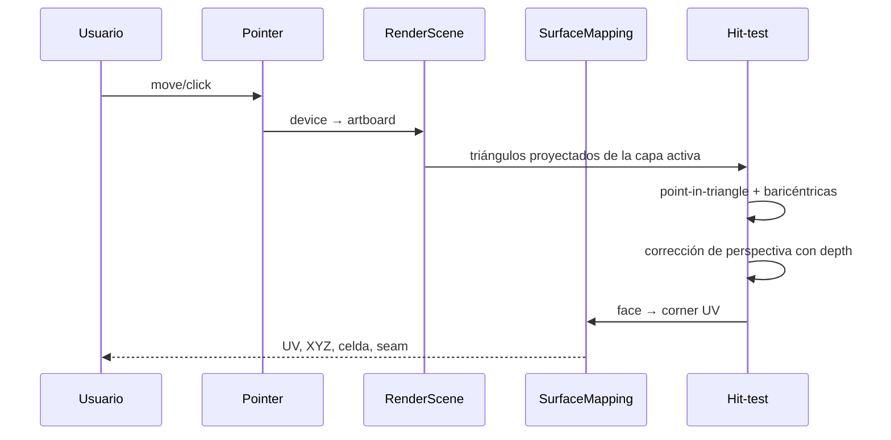

# UV Surface Mapping — Diagnóstico arquitectónico

> **Estado:** diagnóstico read-only. No implementa UV picking, no modifica
> `RenderScene`, `ViewTransform` ni la UI, y no crea commits.
>
> **Fase:** 3 — UV Surface Mapping.
>
> **Fecha:** 2026-11-03.
>
> **Contexto de commits:** `6ab1e82` (coordinate contracts), `ba01e6e`
> (Spatial Reference), `cef497b` (UV Domain inset), `dc66b79` (UV Domain docs).
>
> **Actualización Fase 3A:** `SurfaceMapping` ya está implementado como
> sidecar de evaluación generado junto a la teselación. Conserva dominio,
> celda/triángulo y UV por esquina. Siguen fuera de alcance picking, UI,
> RenderScene y cualquier cambio de render.

---

## 0. Cómo usar este documento

Este documento es la fuente de contexto para una futura implementación de
correspondencia UV ↔ XYZ. Está pensado para que otra IA pueda continuar sin
depender de la conversación original.

Antes de implementar, la siguiente IA debe:

1. Leer este documento completo.
2. Leer `src/geometry/surfaceTessellation.js`, `src/geometry/contracts.js`,
   `src/geometry/validate.js`, `src/view/projection.js`,
   `src/application/renderSceneBuilder.js` y `src/render/scene.js`.
3. Respetar las restricciones de la sección 14.
4. No asumir que los UVs pueden derivarse de XYZ.
5. No usar un UV por vértice como solución a los seams.

Decisiones que **no deberían reabrirse** sin una razón nueva:

- La autoridad paramétrica es `Surface`, no `Mesh`.
- El `Mesh` actual no contiene suficiente información UV.
- Los seams no duplican vértices; sueldan índices.
- Un UV por vértice es ambiguo en seams y twists.
- El picking no debe basarse en painter ordering.
- `ViewTransform` no debe convertirse en un sistema UV.

---

## 1. Resumen ejecutivo

La arquitectura actual permite:

- generar una `Surface` con dominio U/V real;
- visualizar ese dominio en un inset read-only;
- teselar la superficie a `Mesh`;
- proyectar y renderizar la malla en canvas, Quad, SVG y plotter.

La arquitectura actual **no permite una correspondencia UV ↔ XYZ robusta**:

- la teselación suelda los seams y descarta el último sample del eje cerrado;
- los twists se implementan con `wrap + flip` de índices;
- un mismo vértice XYZ puede representar varias coordenadas UV;
- `Mesh.uvs` existe pero nunca se rellena;
- `Mesh.uvs` es por vértice, no por esquina de cara;
- `mesh.meta` no conserva los endpoints reales de `Surface.domain`;
- no se guarda la celda paramétrica de cada triángulo;
- la malla proyectada pierde las coordenadas world;
- en ortográfico todos los vértices tienen `depth = 0`;
- no existe picking, ray casting ni inverse de `ViewTransform`.

**Conclusión:** se necesita conservar información adicional durante la
teselación. La solución recomendada es un `SurfaceMapping` explícito con UVs
por esquina de triángulo, celda paramétrica y dominio real, además de preservar
world coords/profundidad en la malla proyectada.

---

## 2. Flujo actual



### 2.1 Camino de una superficie

1. `parametric-surface.generate(params, ctx)` evalúa `x(u,v), y(u,v), z(u,v)`
   sobre un grid regular.
2. Devuelve una `Surface` con:
   - `domain.u = [u0,u1]`;
   - `domain.v = [v0,v1]`;
   - `closedU/V`;
   - `seamU/V`.
3. `evaluateSurfaceDocument` guarda la Surface, la tesela y proyecta la malla.
4. `buildRenderScene` vuelve a proyectar desde world para construir la escena
   artboard-space.
5. `surface-fill` y `surface-wireframe` dibujan la malla.
6. El UV Domain inset lee `Surface.domain` y `Surface.grid` en paralelo, sin
   tocar la escena.

### 2.2 Observación importante

El camino actual de `parametric-surface` **no aplica el stack de operadores**:
`evaluateSurfaceDocument` tesela directamente después del generador. Esto
simplifica el mapping actual, pero cualquier futuro operador de superficies
puede transformar la topología y deberá participar en el contrato.

---

## 3. Archivos y funciones relevantes

| Etapa | Archivo / función | Responsabilidad |
|---|---|---|
| Contrato Surface | `src/geometry/contracts.js` · `createSurface` | `domain`, `grid`, `meta` |
| Contrato Mesh | `src/geometry/contracts.js` · `createMesh` | `vertices`, `faces`, `normals`, `faceNormals`, `uvs`, `meta` |
| Generación | `src/generators/parametricSurface.js` · `generate` | Evalúa `x(u,v), y(u,v), z(u,v)` |
| Dominio | `parametricSurface.js` · `domain` | `u0/u1`, `v0/v1`, `closedU/V`, `seamU/V` |
| Validación Surface | `src/geometry/validate.js` · `validateSurface` | Grid rectangular, dominio, seams |
| Teselación | `src/geometry/surfaceTessellation.js` · `tessellateSurface` | Welding, wrap/flip, triángulos y normales |
| Validación Mesh | `validate.js` · `validateMesh` | Índices, caras, `uvs` por vértice |
| Evaluación | `src/core/engine.js` · `evaluateSurfaceDocument` | Cache world, teselación, proyección y wireframe |
| Wireframe | `src/geometry/wireframe.js` · `meshWireframeCurves` | Iso-líneas desde `mesh.meta` |
| Proyección | `src/view/projection.js` · `projectMeshToView` | Vértices a view/artboard |
| Transform | `src/view/transform.js` · `createViewTransform` | Cámara, frame, `toArtboard`, `toDevice` |
| Escena | `src/application/renderSceneBuilder.js` · `buildRenderScene` | Capas, mallas proyectadas, frame |
| Contrato escena | `src/render/scene.js` · `createRenderScene` / `createRenderLayer` | `meshes`, `transform`, `space`, `bbox` |
| Render superficies | `src/render/passes/surface.js` | Wireframe y fill painter-sorted |
| Canvas / Quad | `src/render/p5/P5Adapter.js` | Dibujo, cámara, paneles Quad |
| Dominio UV | `src/geometry/uvDomain.js` | Resumen read-only de `Surface.domain` |
| Inset UV | `src/ui/UVDomainInset.js` | Visualización UI-only del dominio |

---

## 4. Contratos actuales

### 4.1 Surface

```text
Surface {
  kind: 'surface',
  id,
  dimension: 3,
  domain: {
    u: [u0, u1],
    v: [v0, v1],
    closedU: boolean,
    closedV: boolean,
    seamU: 'normal' | 'reverse',
    seamV: 'normal' | 'reverse',
  },
  grid: {
    rows: number,
    cols: number,
    points: Point3D[][],   // points[u][v]
  },
  meta: { ... }
}
```

`Surface` es la autoridad paramétrica. Conserva el dominio real y el grid
world. No contiene caras ni UVs por vértice.

### 4.2 Mesh

```text
Mesh {
  kind: 'mesh',
  id,
  dimension: 3,
  vertices: Point3D[],
  faces: number[][],        // triángulos [a,b,c]
  normals: Vector3[] | null,
  faceNormals: Vector3[] | null,
  uvs: UV[] | null,         // por vértice, nunca se rellena hoy
  meta: {
    source: 'surface-tessellation',
    surfaceId,
    uCells,
    vCells,
    closedU,
    closedV,
    seamU,
    seamV,
    twistU,
    twistV,
    gridRows,
    gridCols,
  }
}
```

`Mesh` es topología de render. No conserva:
- `u0/u1`, `v0/v1`;
- la celda paramétrica de cada cara;
- los UVs por esquina;
- las coordenadas world de los vértices proyectados.

### 4.3 UV Domain inset

`src/geometry/uvDomain.js` resume `Surface.domain` y `Surface.grid`:

- endpoints reales;
- min/max;
- dominios invertidos;
- `closedU/V`;
- `seamU/V`;
- filas/columnas.

Es read-only y no participa en el mapping. Es una buena base de UI, no de
correspondencia geométrica.

---

## 5. Teselación, seams y twists

### 5.1 Grid y dominio

El generador recorre:

```text
u = u0 + (u1 - u0) * (uIndex / uCells)
v = v0 + (v1 - v0) * (vIndex / vCells)
```

- `grid.rows = uCells + 1`
- `grid.cols = vCells + 1`
- U avanza por filas.
- V avanza por columnas.
- El dominio puede ser no normalizado o invertido.

### 5.2 Welding

`tessellateSurface` calcula:

```text
uniqueRows = closedU ? gridRows - 1 : gridRows
uniqueCols = closedV ? gridCols - 1 : gridCols
uCells     = closedU ? uniqueRows : uniqueRows - 1
vCells     = closedV ? uniqueCols : uniqueCols - 1
```

Si un eje está cerrado:

- se descarta la última fila/columna del grid;
- se asume que el último sample coincide con el primero;
- se suelda por índice, no se duplica el vértice.

### 5.3 Wrap y flip

```text
wrap(index, size, twist):
  si index dentro de [0,size): { index, flip:false }
  si no: { index: módulo, flip: twist }

corner(u,v):
  wrap U
  wrap V
  si flip U: espeja V
  si flip V: espeja U
  devuelve indexOf(ui,vi)
```

`twistU = closedU && seamU === 'reverse'`
`twistV = closedV && seamV === 'reverse'`

Un seam reverse no es solo estético: cambia qué vértice representa cada
esquina lógica.

### 5.4 Caras

Cada celda lógica genera dos triángulos:

```text
a = corner(u,     v)
b = corner(u + 1, v)
c = corner(u + 1, v + 1)
d = corner(u,     v + 1)

faces.push([a, b, c])
faces.push([a, c, d])
```

El orden es determinista:

```text
faceIndex = 2 * (cellU * vCells + cellV) + triangle
```

Eso permite inferir la celda desde el índice de cara, pero es una convención
implícita y frágil.

### 5.5 Ejemplo de ambigüedad

Para un grid 5×5 cerrado en U y V:

```text
vertices: 16
faces: 32
uvs: null

faces que comparten el vértice 0:
[0, 4, 5], [0, 5, 1], [3, 4, 0],
[12, 0, 1], [15, 3, 0], [15, 0, 12]
```

El vértice 0 representa simultáneamente:

- la esquina `(u0, v0)`;
- esquinas del seam `u1`;
- esquinas del seam `v1`;
- combinaciones con twist si aplica.

Un solo UV por vértice no puede describir eso.

---

## 6. Correspondencia UV ↔ XYZ

### 6.1 Lo que existe

- `Surface.grid.points[u][v]` conserva el punto world evaluado.
- `Surface.domain` conserva los parámetros reales.
- `Mesh.vertices` copia los puntos world durante la teselación.
- `Mesh.faces` conserva la topología triangular.
- `Mesh.meta.surfaceId` enlaza la malla con la Surface.
- `Mesh.meta` conserva flags de cierre/seam/twist y conteos.

### 6.2 Lo que se pierde

- No se guarda el UV de cada esquina.
- No se guarda la celda lógica de cada triángulo.
- No se guardan `u0/u1` ni `v0/v1` en el mesh.
- No se guarda el índice lógico antes del wrap/flip.
- No se guarda la coordenada world en la malla proyectada.
- En ortográfico se pierde el eje eliminado.

### 6.3 ¿Un vértice puede tener múltiples UVs?

**Sí.** En ejes cerrados, un vértice del seam aparece en la primera y en la
última celda. En twists, el flip cambia la coordenada opuesta. El mismo XYZ
puede corresponder a varios pares `(u,v)`.

### 6.4 ¿Los seams duplican vértices?

**No.** Los seams sueldan: se elimina el último sample y se envuelven índices.
No hay vértices duplicados con UVs distintas.

### 6.5 ¿Se pueden reconstruir los UVs?

| Caso | ¿Reconstruible? |
|---|---|
| Ejes abiertos + Surface disponible | Sí, con la convención de grid |
| Ejes cerrados normales | Parcialmente; se pierde el intervalo del seam |
| Ejes cerrados con twist | No de forma fiable desde el vértice |
| Solo Mesh, sin Surface | No: faltan dominio y convención |
| Mesh reordenada/fusionada | No |
| XYZ → UV por posición | No en general |

No se puede asumir que UV se deriva de XYZ: una superficie puede
autointersectarse, solaparse o tener discontinuidades de parametrización.

### 6.6 ¿La información actual identifica una cara y sus UVs?

Hoy:

- se puede inferir la celda desde `faceIndex` y `uCells/vCells` por el orden
  determinista de teselación;
- **no** se pueden inferir los UVs originales de las esquinas sin reconstruir
  `wrap/flip` y el dominio;
- esa reconstrucción es frágil y no está encapsulada.

**Falta información explícita.**

---

## 7. Interpolación

### 7.1 Triángulos

La teselación ya divide cada celda en dos triángulos. El mapping debe trabajar
por triángulo, no por quad.

### 7.2 Ortográfico

La proyección es afín. Las baricéntricas 2D en artboard interpolan UV y XYZ
linealmente:

```text
P  = λ0*A + λ1*B + λ2*C
UV = λ0*UV_A + λ1*UV_B + λ2*UV_C
```

### 7.3 Perspectiva

La interpolación lineal en pantalla es incorrecta. Hay que usar profundidad:

```text
w_i = depth_i * 2 * fov    // proporcional a denom
λ_i^persp = (λ_i / w_i) / Σ(λ_j / w_j)
UV = Σ λ_i^persp * UV_i
```

`project3D` devuelve `depth = denom / (2*fov)`, así que `1/depth` es
proporcional al peso correcto. Hay que proteger `depth = 0`.

### 7.4 Seams

Un triángulo de seam puede tener UVs que saltan de `u1` a `u0`. Eso es
correcto y debe interpolarse con los valores reales por esquina. No se debe
“envolver” el UV durante la interpolación.

### 7.5 Dominios invertidos

Si `u0 > u1` o `v0 > v1`:

- los UVs deben conservar el orden real;
- la interpolación funciona igual;
- la UI puede indicar la dirección invertida, pero la matemática no debe
  reordenar los valores.

### 7.6 Degenerados

Descartar en picking:

- triángulos con área proyectada ~0;
- UVs duplicadas;
- caras con vértices repetidos;
- caras con vértices `null` por near-plane.

---

## 8. Picking y oclusión

### 8.1 Infraestructura existente

**No hay picking.**

- `P5Adapter` usa el mouse solo para cámara y zoom.
- No hay ray casting.
- No hay inverse de `ViewTransform`.
- No hay hit-test de paneles Quad.
- No hay selección de curvas/superficies.

Sí existen:

- `P5Adapter.artboardRect()` para canvas ↔ artboard;
- `ViewTransform.toDevice()` para artboard → device;
- `ViewTransform.project()` y `toArtboard()` para world → view/artboard.

### 8.2 Conversión de coordenadas

```text
device/CSS
  → canvas local
  → artboard: (mouse - artboardCenter) / artboardRect.scale
  → triángulo proyectado
  → baricéntricas
  → UV / XYZ
```

Para una primera inspección no hace falta un ray cast completo: se pueden
proyectar los triángulos y hacer point-in-triangle en artboard.

### 8.3 Profundidad

- Perspectiva: `projectMeshToView` conserva `depth`.
- Ortográfico: `projectPointToView` devuelve `depth: 0` para todos.
- `surface-fill` ordena por profundidad media; en ortográfico todas empatan.
- No hay z-buffer.

Para picking:

- perspectiva: elegir el triángulo con menor profundidad interpolada;
- ortográfico: falta la coordenada world eliminada (por ejemplo Z en XY);
- sin ella no se puede resolver oclusión entre caras solapadas.

Actualmente `projectMeshToView` descarta las coordenadas world del vértice.
Las curvas sí conservan `x3/y3/h3`; las mallas no.

### 8.4 Painter ordering

`surface-fill`:

- calcula profundidad media por cara;
- ordena de lejos a cerca;
- dibuja sin z-buffer.

No es una base fiable para picking. Caras grandes o intersectadas pueden
ordenarse mal.

### 8.5 Canvas single vs Quad

- **Single:** un `RenderScene`, un `ViewTransform`.
- **Quad:** cuatro escenas, una por proyección, cada una con su transform y
  `panelScale`.
- No hay hit-test de panel; `drawQuadView` calcula posiciones localmente y no
  las expone.

Para la primera interacción UV conviene limitarse a **Canvas single**.

### 8.6 Conflicto click/drag

El click/drag actual orbita la cámara. Un click de inspección necesitaría:

- umbral de movimiento para distinguir click de drag;
- o interacción por hover;
- o modificador explícito.

---

## 9. Alternativas de diseño

### A. UVs por esquina de cara

Añadir `faceUVs` paralelo a `faces`, con 3 UVs por triángulo.

**Ventajas**

- Resuelve seams y twists.
- No duplica vértices.
- Es el modelo estándar de mallas con costuras.
- Compatible con exportación futura OBJ/glTF.

**Problemas**

- `Mesh.uvs` actual es por vértice.
- `validateMesh` exige `uvs.length === vertices.length`.
- No resuelve por sí solo la celda paramétrica ni el dominio.

### B. Patches/celdas paramétricas explícitas

Estructura derivada de `Surface.grid` con:

- celda `(iu,iv)`;
- 4 esquinas world;
- 4 UVs reales;
- dos triángulos;
- flags de seam/twist.

**Ventajas**

- Refleja la naturaleza paramétrica.
- No depende de reconstruir desde el mesh soldado.
- Permite razonar sobre celdas.
- La Surface ya es una tabla de celdas.

**Problemas**

- Puede duplicar posiciones world.
- Hay que decidir si es fuente de verdad o vista derivada.
- Puede crecer en memoria.

### C. Tabla índice de teselación → celda original

`faceCells[faceIndex] = { cellU, cellV, triangle }`, derivando UV desde
`Surface.domain`.

**Ventajas**

- Muy barata.
- Aprovecha el orden determinista actual.
- Permite identificar la celda de una cara.

**Problemas**

- No guarda UVs por esquina.
- Depende de `Surface` en tiempo de interacción.
- Frágil ante cambios de teselación, merge o reordenación.

### D. Híbrido recomendado

**`SurfaceMapping` explícito** derivado de `Surface` + teselación:

- UV por esquina;
- celda paramétrica;
- dominio real;
- referencia a `surfaceId`.

Es la opción que mejor encaja con el código actual: la Surface ya tiene el
grid y el dominio; la teselación ya conoce celdas, cierre y twist; solo falta
materializar la correspondencia lógica antes del wrap/flip.

---

## 10. Arquitectura recomendada

### 10.1 Separación de datos



### 10.2 Contrato propuesto: `SurfaceMapping`

```text
SurfaceMapping {
  surfaceId: string,
  domain: {
    u: [u0, u1],
    v: [v0, v1],
    closedU: boolean,
    closedV: boolean,
    seamU: 'normal' | 'reverse',
    seamV: 'normal' | 'reverse',
    twistU: boolean,
    twistV: boolean,
  },
  grid: {
    rows: number,      // únicos
    cols: number,      // únicos
    uCells: number,
    vCells: number,
  },
  faces: [{
    indices: [a, b, c],
    cell: { u: number, v: number },
    triangle: 0 | 1,
    uv: [{u, v}, {u, v}, {u, v}],
  }]
}
```

Propiedades:

- `uv` se calcula desde coordenadas lógicas **antes** del wrap/flip.
- `indices` referencia los vértices reales del `Mesh`.
- `cell` permite inspección y resaltado.
- `domain` conserva valores reales, incluidos dominios invertidos.
- No es una geometría nueva.
- No depende de `ViewTransform`.

### 10.3 Dónde generarlo

Junto a la teselación, en `surfaceTessellation` o un módulo hermano
`surfaceMapping.js`:

- recorre las mismas celdas que `tessellateSurface`;
- calcula `uv` lógico;
- conserva la celda;
- asocia cada triángulo con sus tres UVs.

No conviene reconstruirlo en UI ni en renderer: la UI no debería conocer
`wrap/flip`.

### 10.4 Dónde conservarlo

Opciones:

1. `mesh.surfaceMapping` top-level. Los spreads actuales de proyección lo
   preservarían.
2. `evaluation.surfaceMappings` sidecar keyed by `surfaceId`.
3. `RenderScene.layer.surfaceMappings`.

Recomendación:

- sidecar de evaluación keyed by `surfaceId`;
- referencia/tabla en `RenderScene` de la capa activa;
- no meterlo como blob informal en `meta`.

### 10.5 Datos que deben sobrevivir a la proyección

`projectMeshToView` actualmente produce:

```text
{ x, y, depth, depthAlpha }
```

Conviene conservar:

```text
{
  x, y,
  depth, depthAlpha,
  world: { x, y, z },     // o x3/y3/h3
  orthoDepth?: number,    // eje eliminado en ortográfico
}
```

Con eso:

- se interpola XYZ con baricéntricas world;
- se resuelve profundidad en perspectiva;
- se resuelve oclusión en ortográfico;
- no se reconstruye XYZ desde artboard.

### 10.6 Flujo de inspección



Primera interacción:

- solo inspección;
- capa activa y superficie activa;
- hover o click con umbral;
- sin edición;
- sin snapping;
- sin unidades;
- sin CAD.

---

## 11. Cambios mínimos necesarios

1. **Materializar `SurfaceMapping` durante la teselación**
   - dominio real;
   - topología;
   - celda por triángulo;
   - UV por esquina.

2. **Ajustar el contrato de UVs**
   - no usar `uvs` por vértice como fuente de verdad;
   - añadir `faceUVs`/`surfaceMapping` o sidecar;
   - actualizar `validateMesh` si se añade un campo.

3. **Preservar world coords o profundidad ortográfica**
   - `projectMeshToView` debe conservar `x3/y3/h3` o `world`;
   - en ortográfico, conservar el eje eliminado.

4. **Exponer el mapping en `RenderScene`**
   - la interacción no debería leer `App` directamente;
   - `RenderScene` ya lleva `transform`, `meshes`, `space`; falta la
     referencia paramétrica.

5. **Extraer el layout de Quad**
   - función pura `quadPanels(artboard)` para hit-test futuro.

6. **Añadir utilidades de picking**
   - device → artboard;
   - point-in-triangle;
   - baricéntricas;
   - corrección perspectiva;
   - selección por profundidad.

7. **Tests de contrato**
   - seams normales y reverse;
   - U/V cerrados, uno cerrado, ambos abiertos;
   - dominios invertidos;
   - caras degeneradas;
   - perspectiva y ortográfico;
   - múltiples superficies/capas.

---

## 12. Riesgos y pruebas requeridas

### 12.1 Riesgos

| Riesgo | Impacto |
|---|---|
| Seam welding sin duplicar vértices | Un UV por vértice es ambiguo |
| Twist con flip de la coordenada opuesta | La celda lógica no coincide con el índice |
| Dominio no guardado en `mesh.meta` | No se recuperan UVs reales desde Mesh |
| `uvs` por vértice | Insuficiente para costuras |
| `projectMeshToView` descarta world coords | XYZ y oclusión ortográfica no recuperables |
| `depth = 0` en ortográfico | Oclusión y orden ambiguos |
| Painter ordering sin z-buffer | Picking y render pueden discrepar |
| Near-plane con vértices `null` | Caras parcialmente visibles desaparecen |
| Quad sin hit-test de panel | Picking Quad no reutilizable |
| Click vs drag de cámara | Conflicto de interacción |
| Superficies sin operadores | Futuros operadores pueden cambiar topología |

### 12.2 Pruebas necesarias

**Dominio**

- `u0/u1`, `v0/v1` reales;
- dominios invertidos;
- dominios fuera de `[0,1]`;
- dominios degenerados.

**Seams**

- U cerrado normal;
- V cerrado normal;
- ambos cerrados;
- U reverse;
- V reverse;
- ambos reverse;
- seam con gap.

**Teselación**

- número de vértices y caras;
- vértice compartido en seam;
- celda lógica por cara;
- UV por esquina;
- triángulos degenerados.

**Interpolación**

- triángulo plano ortográfico;
- triángulo en perspectiva;
- seam con salto UV;
- dominio invertido;
- baricéntricas fuera del triángulo.

**Picking**

- hit/miss;
- triángulo más cercano;
- oclusión dentro de la superficie;
- capa oculta;
- múltiples superficies;
- Quad por panel;
- conflicto click/drag.

**Regresión**

- canvas, SVG y plotter sin cambios;
- UV Domain inset sin cambios;
- Spatial Reference sin cambios;
- frame y bbox sin cambios;
- rendimiento y memoria en grids grandes.

---

## 13. Fases posteriores propuestas

### Fase 3A — Contrato de mapping

- Añadir `SurfaceMapping` derivado de `Surface` + teselación.
- UVs por esquina, celda por triángulo, dominio real.
- Tests de seams/twists/dominios.

Sin UI, sin picking.

### Fase 3B — Datos proyectados

- Conservar world coords/profundidad ortográfica en mallas proyectadas.
- Exponer mapping en `RenderScene`.
- Tests de proyección y oclusión.

Sin interacción.

### Fase 3C — Inspección single Canvas

- Hover/click sobre la superficie activa.
- Leer UV, XYZ, celda y seam.
- Resaltar triángulo/celda.
- Sin edición, sin snapping, sin unidades.

### Fase 3D — Multi-superficie y Quad

- Picking por panel.
- Selección entre superficies/capas.
- Oclusión más robusta.
- Posible actualización del UV Domain inset con marcador.

### Fuera de alcance

- Edición directa de mallas.
- UV ↔ XYZ interactivo completo.
- Unidades físicas.
- CAD.
- Fabricación 3D.
- Exportación UV.

---

## 14. Alcance de producto y restricciones

Parametrica sigue siendo una herramienta de geometría paramétrica y
exploración generativa, no un CAD.

La primera interacción UV futura debe ser **inspección**:

- identificar un punto de la superficie;
- mostrar sus coordenadas UV;
- mostrar su posición XYZ;
- visualizar seams y discontinuidades.

No debe incluir todavía:

- edición directa de mallas;
- snapping;
- unidades físicas;
- exportación UV;
- operaciones CAD;
- fabricación 3D.

Restricciones para la siguiente implementación:

- no cambiar `ViewTransform` para UV;
- no cambiar `RenderScene` sin justificar el mapping;
- no usar painter ordering para picking;
- no asumir UV desde XYZ;
- no romper canvas, SVG, plotter, PNG/GIF;
- no alterar frame, bbox ni geometría.

---

## 15. Conclusión explícita

**La arquitectura actual no permite una correspondencia UV ↔ XYZ robusta por
sí sola.**

Permite:

- conocer el dominio real;
- visualizarlo;
- proyectar la superficie;
- identificar visualmente la forma.

No permite:

- recuperar UVs por esquina desde el `Mesh`;
- resolver seams y twists con un UV por vértice;
- identificar de forma explícita la celda paramétrica de cada cara;
- resolver XYZ/oclusión en ortográfico desde los vértices proyectados actuales;
- hacer picking sin infraestructura adicional.

La implementación futura necesita conservar información adicional durante la
teselación: **dominio real, celda lógica por triángulo y UVs por esquina**,
además de preservar world coords/profundidad en la malla proyectada.

La opción recomendada es un `SurfaceMapping` explícito derivado de `Surface` +
teselación, no un UV por vértice.

---

## 16. Handoff breve para la siguiente IA

```text
Contexto: Parametrica Fase 3, UV Surface Mapping.
Estado: diagnóstico read-only. No implementar sin una nueva instrucción.

Hechos:
- Surface.domain es la autoridad paramétrica.
- tessellateSurface suelda seams y descarta el último sample del eje cerrado.
- Los twists usan wrap + flip.
- Mesh.uvs existe pero es null y es por vértice.
- Un vértice puede tener múltiples UVs en seams/twists.
- mesh.meta no guarda u0/u1/v0/v1 ni la celda por cara.
- projectMeshToView pierde world coords y usa depth=0 en ortográfico.
- No hay picking, ray casting ni inverse de ViewTransform.
- surface-fill usa painter ordering sin z-buffer.

Decisión recomendada:
- SurfaceMapping explícito con dominio, celda por triángulo y UV por esquina.
- Preservar world coords/profundidad en mallas proyectadas.
- Exponer mapping en RenderScene.
- Picking por triángulo proyectado, no por painter order.
- Primera interacción: inspección en Canvas single.

No reabrir:
- UV por vértice como solución.
- Derivar UV desde XYZ.
- Usar painter ordering para picking.
- Meter UV en ViewTransform.

Validación:
- seams normal/reverse, cerrados/abiertos, dominios invertidos,
  perspectiva/ortográfico, degenerados, múltiples superficies/capas.
```
